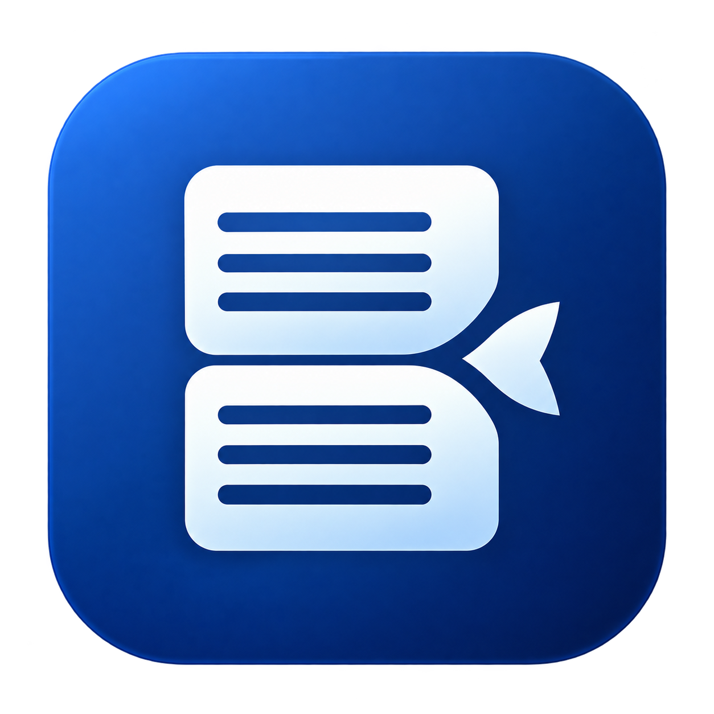

# 摸鱼助手（adfish）

<p align="center">
  
</p>

摸鱼助手（adfish）是一个主要用于摸鱼的小窗口浏览器。启动后直接打开主页，默认开启隐身模式：移出窗口隐藏，回到原位置恢复，同时支持多种配色和自动保存设置。

支持 **Windows 10/11 64 位（x64、ARM64）**。

## 隐身模式

首次运行默认开启，已有用户的选择继续保留。移出窗口和菜单会隐藏整个窗口，鼠标回到窗口当前位置时恢复；启动后可将鼠标移至主屏右下角、任务栏上方唤回窗口，也可在设置中关闭。隐藏不会关闭网页；开启“离开时暂停网页”可同时暂停播放。未开启时，隐藏不会暂停或自动静音；手动最小化需通过任务栏恢复。

双击 **Alt** 可切换手动隐身：隐藏后鼠标返回也不会显示，必须再次双击 Alt。此快捷键独立于自动隐身开关。

## 安装与运行

### 下载发布版

1. 在仓库 **Releases** 选择对应版本：Intel/AMD 电脑下载 **adfish-Windows-x64.zip**，Windows ARM 电脑下载 **adfish-Windows-arm64.zip**。
2. 完整解压后双击 **adfish.exe**。
3. 双击 **创建快捷方式.cmd**，创建名为 **adfish** 的桌面快捷方式。

无需安装 Node.js 或 WebView2。请保留 EXE 旁的全部资源文件，不要只复制 EXE。创建快捷方式后移动程序目录，需要重新创建快捷方式。

### 从源码运行

安装 **Node.js 22.12 或以上版本**，下载或克隆源码，在项目目录执行：

```powershell
npm ci
npm start
```

首次安装依赖需要联网。安装后也可双击源码目录的 **启动.cmd**；双击 **创建快捷方式.cmd** 可创建 adfish 桌面快捷方式。

如果 PowerShell 提示无法运行 `npm.ps1`，改用 `npm.cmd ci` 和 `npm.cmd start`。

## 操作说明

- **网页导航：** 顶部小房子右侧的按钮依次为后退、前进、刷新；没有可用历史或网页时，对应按钮禁用。
- **首页：** 点击顶部左侧的小房子图标，回到设置中的主页网址。
- **浏览菜单：** 点击右上角「⋯」，可定位网址栏、调节音量、静音、置顶和打开设置。鼠标进入菜单后移出，菜单自动收起。
- **访问网站：** 在顶部网址栏填写网址或关键词，按回车访问；关键词使用 Bing 搜索。
- **移动与缩放：** 拖动顶部栏空白处移动，拖动边缘调整大小，也可在设置中输入尺寸。双击边框不会最大化。
- **主题与设置：** 在设置中选择科技蓝、自然绿、活力红或暖琥珀，修改主页和窗口标题。所有有效修改自动保存，无需点击保存。
- **网页缩放：** 默认随窗口等比例缩放，文字较小时可增大窗口或在设置中关闭缩放。
- **离开时暂停网页：** 在设置中开启后，鼠标移出窗口会暂停正在播放的视频和音频，回来后继续播放；原本暂停的媒体不会自动播放。默认关闭，可独立于隐身模式使用。
- **快速关闭：** 默认启用，在 450 毫秒内双击 Ctrl 退出软件，隐身、最小化或窗口未聚焦时也有效。在设置中可关闭，或点击按键框录入其他单个按键；Alt 保留为手动隐身按键，录入时暂停上述快捷键。
- **视频全屏：** 点击播放器全屏按钮，视频铺满小窗口内的网页区域，窗口大小和顶部栏保持原状。按 Esc 或播放器退出按钮恢复正常网页和缩放；隐身仍然生效，双击标题栏或边框不会最大化。

### 快捷键

| 快捷键 | 操作 |
| --- | --- |
| 双击 Alt | 切换手动隐身 |
| 双击 Ctrl | 快速关闭（可自定义或关闭） |
| Ctrl + L | 选中顶部网址栏 |
| F5 / Ctrl + R | 刷新 |
| Alt + ← / Alt + → | 后退 / 前进 |
| Esc | 退出视频页内全屏、取消网址编辑，或关闭菜单和设置 |

设置和登录数据默认保存在程序旁的 `data` 目录，目录不可写时使用 `%APPDATA%/AdWindow`。网站登录是否持续有效取决于网站策略；程序不提供密码管理器，重启后不自动恢复上次网址。分享程序时不要包含个人 `data` 目录。

采用 [MIT 许可证](LICENSE) 开源。
